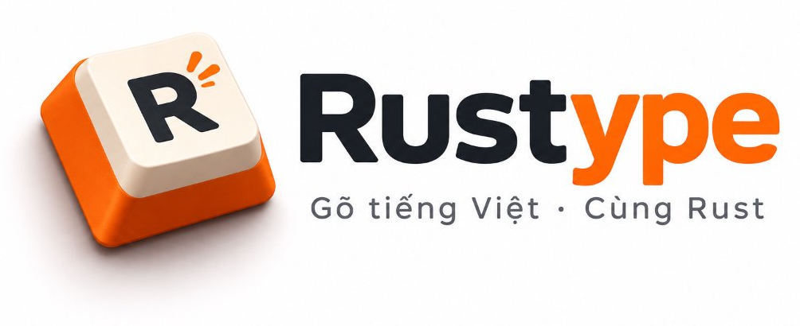

<p align="center">
  
</p>

<p align="center">
  <strong>Bộ gõ tiếng Việt siêu nhẹ, hiệu năng cao viết bằng Rust cho Linux (IBus & Wayland).</strong>
</p>

<p align="center">
  <a href="https://www.rust-lang.org/"></a>
  
  
</p>

Bộ gõ tiếng Việt Telex và VNI cho IBus, viết hoàn toàn bằng Rust, không phụ thuộc thư viện runtime bên ngoài.
Thiết kế tối ưu cho Ubuntu GNOME trên Wayland, gõ mượt mà không lỗi trong terminal (Ptyxis, Alacritty, Claude Code) và các ứng dụng đồ họa (VS Code, Chrome, LibreOffice).

## Điểm nổi bật

- **Gõ trong terminal không lặp chữ.** Terminal không cho bộ gõ sửa chữ đã gõ, nên Rustype giữ từ đang gõ ở dạng gạch chân và gửi đi khi hết từ, không gửi phím xóa lùi giả.
- **Bấm chuột không mất chữ.** Chữ gạch chân được gửi ở chế độ COMMIT, nên GNOME giữ lại từ đang gõ dở khi bạn bấm chuột hoặc đổi cửa sổ.
- **Không gạch chân ở ứng dụng thường.** Ứng dụng có Surrounding Text như trình duyệt hay VS Code nhận chữ trực tiếp, chỉ terminal mới gạch chân.
- **Rất nhẹ.** Khoảng 2,5 MB RAM, file chạy khoảng 450 KB, mỗi phím xử lý trong khoảng 0,3 micro giây.
- **Telex đầy đủ.** Đặt dấu kiểu cũ hoặc kiểu mới, tự trả lại từ tiếng Anh như "window", "software", "user", gõ đôi phím để thoát như "ss" hay "dd".

## Cài đặt

### Cách 1: Cài đặt bằng gói `.deb` (Khuyên dùng cho Ubuntu / Debian)
Tải gói `.deb` từ mục [Releases](https://github.com/namtr/rustype/releases) hoặc tự đóng gói nhanh bằng:
```bash
make deb
sudo apt install ./target/packages/rustype_*.deb
```

### Cách 2: Cài đặt từ mã nguồn (Dành cho nhà phát triển)
Cần Rust (`rustup`). Chạy script cài đặt:
```bash
./install.sh
```

Sau đó nhấn Super+Space để chọn Rustype (biểu tượng là "VN").
Gỡ cài đặt bằng `./uninstall.sh` hoặc `sudo apt remove rustype`.

Giao diện Cài đặt đồ họa: mở **Cài đặt Rustype** từ màn hình ứng dụng (hoặc chạy `rustype-settings`).
Chẩn đoán hệ thống tự động: chạy `ibus-engine-rustype --doctor`.

## Cấu hình

File `~/.config/rustype/config`, sửa xong bấm sang ô gõ khác là có hiệu lực:

```
mode = auto                 # auto | preedit | direct
input_method = telex        # telex | vni
modern_orthography = false  # false: hòa, khỏe, thúy   true: hoà, khoẻ, thuý
auto_restore_english = true # tự trả lại từ tiếng Anh
enable_macro = true         # gõ tắt từ ~/.config/rustype/macro
remember_state_per_app = true # nhớ trạng thái bật/tắt theo từng app (như EVKey)
custom_words = this, test   # từ tiếng Anh không bị thêm dấu
```

- `auto`: không gạch chân ở ứng dụng thường, gạch chân trong terminal. Nên dùng.
- `preedit`: luôn gạch chân.
- `direct`: không bao giờ gạch chân. Terminal trên Wayland sẽ bị lặp chữ.

Ô mật khẩu luôn được bỏ qua, phím đi thẳng vào ứng dụng.

## Tài liệu

| Tài liệu | Dành cho | Nội dung |
|---|---|---|
| [Tương thích](docs/COMPATIBILITY.md) | Mọi người | Ma trận ứng dụng, cơ chế hiện chữ, tùy biến cấu hình theo ứng dụng (app_modes) |
| [Quyền riêng tư](docs/PRIVACY.md) | Mọi người | Cam kết 100% ngoại tuyến, không telemetry, không keylogging |
| [Xử lý sự cố](docs/TROUBLESHOOTING.md) | Người dùng | Kiểm tra cài đặt, gạch chân, lặp chữ, từ tiếng Anh bị thêm dấu, báo lỗi |
| [Kiến trúc](docs/ARCHITECTURE.md) | Người phát triển | Các module, đường đi của một phím, ba cách hiện chữ, lõi Telex, giao thức IBus |
| [Phát triển](docs/DEVELOPMENT.md) | Người phát triển | Build, ba mức kiểm thử, sinh bảng luật, gỡ lỗi trên máy thật |
| [Lộ trình](docs/ROADMAP.md) | Mọi người | Kế hoạch từ bản 0.1 tới bản 1.0 cho Linux, rồi Windows và macOS |
| [Thay đổi](CHANGELOG.md) | Mọi người | Những gì thay đổi qua từng phiên bản |

## Giấy phép

Rustype dùng giấy phép MIT, xem [LICENSE](LICENSE).
